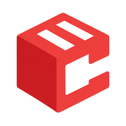

<p align="center"></p>

# Crateview

[Website](https://crateview.de) · [Security](SECURITY.md) · [Buy Me a Coffee](https://buymeacoffee.com/tobiaswaelde)

Crateview is a modern, themeable dashboard for Docker and OCI container registries, built with Nuxt 4 and Nuxt UI 4. It uses the standard Registry HTTP API V2, OCI manifests and image configs.

## Local development

Requires Node.js 26.13.0 or newer within v26 and a running Distribution registry.

```sh
npm ci
cp .env.example .env
npm run dev
```

UI: http://localhost:3000. Default registry: http://127.0.0.1:5000. Hot module replacement is enabled.

### Dependency licenses

Settings includes an About section with the application version and searchable dependency
licenses, including development tools and transitive packages. Expand a package to read
its original license texts and notices. Missing metadata or texts are explicitly labeled.

`npm run dev` and `npm run build` automatically generate
`public/dependency-licenses.json` from `package-lock.json` and locally installed packages.
The generated file is ignored by Git and included in the production output, including
Docker builds. To refresh it manually after changing dependencies:

```sh
npm run licenses:generate
```

Packages that are not installed on the build platform remain in the list using their
lockfile metadata; their license texts are unavailable. No external license service is
queried.

### Local Docker registry with demo images

Run these commands from `registry-ui`. This development stack exposes an anonymous
registry only on `127.0.0.1:5050`, avoiding the macOS service on port 5000. Images
persist in the `dev-registry-data` Docker volume.

```sh
docker compose -p crateview-dev -f compose.dev.yaml up -d
curl --fail --retry 10 --retry-connrefused --retry-delay 1 http://127.0.0.1:5050/v2/

# Pull only if alpine:latest is not already available locally.
docker image inspect alpine:latest >/dev/null 2>&1 || docker pull alpine:latest
for repository in alpine demo/backend demo/frontend; do
  for tag in latest v1; do
    docker tag alpine:latest "localhost:5050/$repository:$tag"
    docker push "localhost:5050/$repository:$tag" || exit 1
  done
done

# Override the upstream without changing an existing .env file.
NUXT_REGISTRY_UPSTREAM=http://127.0.0.1:5050 npm run dev
```

Open http://localhost:3000. The catalog contains `alpine`, `demo/backend` and
`demo/frontend`, each with `latest` and `v1` tags sharing the same Alpine image.
The separate E2E fixture and seed script continue to use port 5001.

Stop the dev server with Ctrl+C. Stop the registry while preserving its data:

```sh
docker compose -p crateview-dev -f compose.dev.yaml down
```

The frontend is a SPA. Nitro reads runtime ENV and talks to the registry server-side, avoiding browser CORS requirements. `/v2/**` is a streaming proxy for Docker/Podman/ORAS clients; `/api/registry/**` derives UI metadata from catalog, tags, manifests and config blobs. Raw manifest and config JSON can be inspected and copied from image details.

## Run the complete stack

```sh
docker compose pull
docker compose up -d
```

Compose pulls the public `ghcr.io/crateview/registry-ui:v0.1.0` image (Linux amd64) and starts `registry:3.1.2` and the frontend, exposes only http://localhost:3000 and persists registry storage in the `registry-data` volume. CLI example:

```sh
docker tag alpine:latest localhost:3000/alpine:latest
docker push localhost:3000/alpine:latest
docker pull localhost:3000/alpine:latest
```

For a standalone frontend, set `NUXT_REGISTRY_UPSTREAM` to your existing registry origin. Production starts with `HOST=0.0.0.0 PORT=3000 node .output/server/index.mjs`. `.env` is read automatically in development/build; the production Node process uses actual environment variables. Never put registry credentials into `NUXT_PUBLIC_*` or the upstream URL.

## Registry-native capabilities

- Paginated catalog/tag discovery, repository-name search and tag suggestions, alphabetical sorting.
- Repository and tag details, OCI/Docker multi-platform manifests, config-derived OS/architecture and image creation time, compressed layer sizes and history.
- OCI annotations/labels for description, vendor, source, docs and license. Registry push time and download counts are not available from this API and are not invented from image creation times.
- Raw manifest/config documents, OCI referrers and artifact annotations, with the standard digest-tag index fallback for registries without a referrers endpoint. The UI reads fallback indexes maintained by OCI clients; it does not invent an index by scanning all manifests.
- Docker, Podman, Skopeo and ORAS commands and clipboard support.
- Anonymous access, native `htpasswd` Basic Auth, and an optional independent [account service](auth/README.md) with Distribution token authorization. UI users can change passwords; an ENV allowlist controls account administration. External token/Bearer services and OIDC remain unsupported.
- Favorites, CVE scanning, a dependency index, download statistics and signature trust verification are outside the standard registry API and are not implemented. Referrer artifacts may contain signatures, but listing them does not claim cryptographic validation.

Metadata is loaded on demand, with bounded parallelism per request. Name search loads the full paginated catalog; platform metadata is derived for visible repositories rather than pretending there is a server-side metadata search index. Large tag lists can require many requests to obtain sortable creation dates.

## Authentication and deletion

Basic credentials are validated against `/v2/`; managed token mode validates them through the independent account service. The server stores them only in an encrypted, HttpOnly, SameSite=Strict session cookie, never localStorage. Session lifetime is eight hours. HTTPS enables the Secure cookie flag. Set a cryptographically random `NUXT_SESSION_PASSWORD` (at least 32 characters) for stable production sessions:

```sh
openssl rand -base64 32
```

Without a configured secret, a random process-local secret is generated; restarting the process invalidates sessions. All instances behind a load balancer must share the same secret. The registry remains responsible for access control. Logout clears the UI session; it does not administer registry users.

Manifest deletion is off by default in the UI. Enable `NUXT_REGISTRY_DELETE_ENABLED=true` and enable `storage.delete.enabled` in Distribution to expose it. Standard deletion uses a **digest**, not a tag: all tags pointing at that manifest are affected. The confirmation lists these tags. A concurrent registry writer can change references after the preview; there is no registry transaction API to lock aliases. Deletion does not run garbage collection or promise immediate disk reclamation.

## Optional account management

See [the account service guide](auth/README.md) for both modes, Compose overlays, bootstrap, CLI and token grants. Account storage uses `htpasswd` and a JSON grants file, with no SQLite. Docker can connect directly to Distribution independently of the UI. Set `NUXT_USER_CREATION_ALLOWED_USERS` to a comma-separated allowlist or `*`; the default allows nobody to administer accounts through the UI. The Administration section contains Settings and the Users page. The ENV allowlist controls account listing, creation, password resets and deletion. Each user row has a right-aligned three-dot menu; deleting another account requires confirmation and removes its grants. The current user’s menu links to Account; self-deletion is blocked. Token grants remain read-only in the UI. Password changes under Account require the current password. Forms and account APIs share Zod validation.

## Branding and theme

See [.env.example](.env.example). Runtime `NUXT_PUBLIC_BRAND_*` variables control name, description, separate light/dark logos, favicon, page title template and optional links. Runtime `NUXT_PUBLIC_THEME_*` variables override the defaults in `app/app.config.ts`: primary `red`, neutral `zinc`, radius and font family. Other Nuxt UI component/icon overrides use standard `ui` app config; CSS tokens live in `app/assets/css/main.css`.

Use private `NUXT_BRAND_LOGO_LIGHT_FILE`, `NUXT_BRAND_LOGO_DARK_FILE`, and `NUXT_BRAND_FAVICON_FILE` variables to serve files from the server filesystem without rebuilding. A configured file overrides its corresponding public URL; unset file variables preserve URL behavior. Absolute paths are supported; relative paths resolve against the server working directory (`/app` in the Docker image). SVG, PNG, JPEG, WebP, GIF, and ICO files are supported. Configured files must be readable, nonempty regular files with a supported extension; invalid settings stop startup. Assets are loaded at startup: restart after changing a path or file contents. Only fixed public asset URLs reach the browser, including on the sign-in page; filesystem paths remain private.

For Docker Compose, create a `compose.branding.yaml` override:

```yaml
services:
  frontend:
    volumes:
      - ./branding:/app/branding:ro
    environment:
      NUXT_BRAND_LOGO_LIGHT_FILE: /app/branding/logo-light.svg
      NUXT_BRAND_LOGO_DARK_FILE: /app/branding/logo-dark.svg
      NUXT_BRAND_FAVICON_FILE: /app/branding/favicon.ico
```

Create the three files in `./branding`, ensure the container's `node` user can read them, then run `docker compose -f compose.yaml -f compose.branding.yaml up -d`. Paths in these variables refer to files inside the container, not host paths. Logo files and favicons are public assets; do not configure confidential files.

Defaults use the system color scheme. Users can select System/Light/Dark and one of 13 interface languages; preferences persist independently of sign-out. Custom logos/fonts can be bundled under `public/` or served via configured HTTP(S) URLs. No theme-color editor is shown to end users.

## Checks

```sh
npm run typecheck
npm run lint
npm test
npm run format:check
npm run build
npx playwright install chromium
npm run test:branding:integration
```

The browser suite reads the local registry on port 5000 containing `alpine:latest`. Its Basic Auth, deletion, multi-platform and referrer tests use a **separate official Distribution container** on port 5001 and a branded frontend on port 3001. Test data uses tmpfs; production/local registry data is not deleted.

```sh
# Separate terminal; requires Docker and an existing production frontend build.
node tests/registry-fixture.mjs
# Seed only the isolated test registry from local Alpine, then run browser tests.
node tests/seed-registry.mjs
npm run test:e2e
```

Test-only credentials: `developer` / `test-password`. Stop the fixture with Ctrl+C. Re-seed before repeating the suite because it intentionally deletes only the isolated `deletable` repository's manifest and aliases. `PLAYWRIGHT_CHROMIUM_EXECUTABLE` can select an installed Chromium.

## Support and maintenance

Support development through [Buy Me a Coffee](https://buymeacoffee.com/tobiaswaelde). GitHub funding links are configured in `.github/FUNDING.yml`.

Dependabot checks npm dependencies, Dockerfile and Compose images, and GitHub Actions weekly. The CI workflow validates types, linting, formatting, unit tests and the production build. Report vulnerabilities through the private channel described in [SECURITY.md](SECURITY.md).

## Brand assets

The Crateview mark combines a container crate and a C-shaped viewing aperture. The transparent master and a UI-sized version live in `public/branding/`. The same mark is used for `public/favicon.ico` (16/32/48 px) and the Apple touch icon. Branding remains replaceable through the existing environment variables.

## Docker updates and source builds

Set `CRATEVIEW_VERSION` in `.env` to a released `v`-prefixed tag (initially `v0.1.0`). Review release notes before updating:

```sh
docker compose pull frontend
docker compose up -d --no-deps frontend
```

To roll back, restore the previous `CRATEVIEW_VERSION` and repeat these commands. Keep the runtime environment and existing data volumes. For a local source build instead:

```sh
docker compose -f compose.yaml -f compose.build.yaml up --build -d
```

## Versioning and releases

Both applications release independently. Run `npm run changeset` for a user-visible change and commit the generated file. Choose a patch, minor or major bump. The workflow maintains a version PR, using `npm run version` to update the package version, lockfile and changelog. Merge that PR to publish the release; do not use `npm version`.

Releases on `main` run the CI checks before publishing to GHCR with `v<version>`, `latest` and `sha-...` tags. Only after verifying the image does the workflow create the Git tag and GitHub release. The initial `0.1.0` release is bootstrapped without a changeset. Rerun the Release workflow after a transient failure; existing tags and releases are preserved. Packages remain private to npm and are never uploaded there. The `release` script exposes the Changesets CLI publishing command; the Docker workflow manages application releases itself.

Release PRs use the repository-scoped, short-lived `GITHUB_TOKEN`. No personal token or `CHANGESETS_PR_TOKEN` secret is required. Enable **Allow GitHub Actions to create and approve pull requests** in the organization and repository Actions settings. Default workflow permissions stay read-only; the release job requests the contents, pull requests, packages and Actions write permissions it needs.

After creating or updating a version PR, the release workflow waits for its native `ci.yml` pull-request run and approves that workflow run when GitHub requires approval for a bot-created PR. This is restricted to the existing CI workflow and the exact version PR head commit; it does not approve a code review or merge the PR. The native CI run reports the required PR checks. After review and successful CI, merge the PR to publish its Docker release. See [GitHub's workflow-triggering rules](https://docs.github.com/en/actions/how-tos/write-workflows/choose-when-workflows-run/trigger-a-workflow#triggering-a-workflow-from-a-workflow).

The `registry-ui` GHCR package is **public** and supports anonymous Docker pulls. The organization allows public packages; new packages still need an explicit visibility choice. Keep the separate website package private.

### Local monitoring dashboard

Create a local `.env` with `NUXT_REGISTRY_UPSTREAM=http://127.0.0.1:5050`,
`NUXT_MONITORING_ENABLED=true`, `NUXT_MONITORING_METRICS_URL=http://127.0.0.1:5051/metrics`,
`NUXT_MONITORING_DATABASE_PATH=.dev/monitoring.sqlite`, and a random
`NUXT_MONITORING_WEBHOOK_SECRET` (generate with `openssl rand -hex 32`).
Then start the existing development registry with its optional monitoring overlay:

```sh
docker compose -p crateview-dev -f compose.dev.yaml -f compose.dev.monitoring.yaml up -d
npm run dev -- --host 0.0.0.0
```

Open **http://localhost:3000/home**. The host binding lets the registry container
deliver notifications to the local Nuxt server. Registry data stays in the existing
`crateview-dev` volume; monitoring history is stored in `.dev/monitoring.sqlite`.
Debug metrics are available only on loopback port 5051. Initial storage rates need
two stable samples, potentially two minutes after new storage actions first appear.
Existing images are preserved; new pulls and pushes populate the activity list.

## Optional Distribution monitoring

Overview is an opt-in operational dashboard; Explore remains the repository catalog.
With monitoring disabled (the default), `/home` redirects to `/explore` and Overview
is hidden. Enabling monitoring explicitly grants registry-wide operational data to
all users who can access the UI, including anonymous users of public registries.
There is no separate administrator role.

For the bundled Distribution deployment, generate a secret with `openssl rand -hex 32`,
set `NUXT_MONITORING_WEBHOOK_SECRET` in `.env`, and run:

```sh
docker compose -f compose.yaml -f compose.monitoring.yaml up -d
```

Requires Docker Compose 2.23 or later. The optional overlay configures an internal
Distribution debug endpoint and notifications, plus a persistent SQLite volume.
The debug port is never published. Do not expose it publicly: Distribution debug
endpoints can contain sensitive data. The overlay supplies a Distribution config
for the bundled filesystem registry; merge it into your own config when using
authentication, another storage driver, or other registry customizations.

For an existing Distribution instance, configure these **server-only** variables:

| Variable                         | Default                  | Purpose                                                                                  |
| -------------------------------- | ------------------------ | ---------------------------------------------------------------------------------------- |
| `NUXT_MONITORING_ENABLED`        | `false`                  | Explicitly enable registry-wide monitoring.                                              |
| `NUXT_MONITORING_METRICS_URL`    | empty                    | Internal HTTP(S) Distribution Prometheus-format endpoint; no Prometheus server required. |
| `NUXT_MONITORING_METRICS_TOKEN`  | empty                    | Optional Bearer token for that endpoint; never forwarded to the registry API.            |
| `NUXT_MONITORING_WEBHOOK_SECRET` | empty                    | Separate Bearer secret for `POST /api/monitoring/events`; empty disables notifications.  |
| `NUXT_MONITORING_DATABASE_PATH`  | `.dev/monitoring.sqlite` | Writable SQLite path. Mount its parent directory persistently (including WAL files).     |

Set Distribution's `http.debug.addr` and `http.debug.prometheus.enabled`, then
configure a notification endpoint pointing at `/api/monitoring/events` with
`Authorization: Bearer <webhook secret>`. Crateview accepts the Distribution event
envelope; only manifest/index `push` and `pull` events are stored. Duplicate event
IDs are ignored within retained history. Failed writes return 503 for registry
retry; success is acknowledged only after commit. Envelopes are limited to 1 MiB
and 1,000 events. Do not reuse a login password as the webhook secret.

One Node 26 server process and one Distribution instance are supported in V1.
Sampling runs every 60 seconds without browser activity. SQLite schema versioning
is automatic; back up the database before upgrades. Data is separated by upstream
origin, retained for 30 days, and pruned on startup and daily. Use a new database
when replacing a registry at the same origin. Restarting Crateview preserves history
but begins a new metric baseline. Missing series, counter resets, collector failures,
and sampling interruptions create gaps; no rate is interpolated over them.

The dashboard offers 24-hour and 7-day views, observed manifest activity, registry
probe latency, storage operation rate and weighted mean operation duration. The
first successful metric sample establishes a baseline; rates need a second sample.
A 401 probe response means reachable with authentication required. The collector
never uses users' credentials. API reads check access against the upstream. Previously verified encrypted sessions
can still read monitoring during network/5xx outages until their existing session
expires (eight hours); new sessions cannot. Explicit 401/403 responses clear the current session.
An outage cannot be used to establish a new authorized session.
No metrics endpoint or notification secret is exposed to the browser.

Manifest access events are **not complete image downloads**. Multi-platform images
and Crateview's own reads can produce multiple events. Notification delivery is
best effort, with no historical backfill or guarantee of completeness; zero observed
events does not prove no traffic occurred. Storage operation metrics are not image
traffic, disk usage, or the global HTTP error rate. No actual storage utilization,
full download count, or global HTTP error rate is provided.

Sources: [Distribution configuration](https://distribution.github.io/distribution/about/configuration/),
[notifications](https://distribution.github.io/distribution/about/notifications/).

Validation (requires Node 26 and Docker):

```sh
npm test
npm run build
npm run test:monitoring:integration
```

The isolated integration test creates and removes its own registry, checks actual
manifest notifications and storage deltas, and can take about two minutes while
waiting for background samples. Browser coverage: `tests/monitoring.spec.ts`.

## Localization

`shared/locales.ts` defines English, German, Simplified Chinese (`zh-CN`), Hindi,
Spanish, Arabic, French, Bengali, Brazilian Portuguese (`pt-BR`), Indonesian,
Urdu, Russian and Japanese. Nuxt i18n, Nuxt UI and language controls use this
catalog. Registry routes remain unprefixed. English is the default and fallback;
`registry-ui-language` remembers explicit choices independently of sign-out.
Arabic and Urdu use RTL; commands, code and technical identifiers remain LTR.

Message dictionaries live in `i18n/locales/<locale>.json`. English is the editorial
reference; preserve interpolation arguments when translating. The eleven new
languages initially use machine translation and have not received native-speaker
review. Update all dictionaries when adding messages; tests enforce coverage and
placeholder parity. Application request errors are localized at the UI boundary;
API responses retain their existing protocol. No runtime translation service is used.

## Automatic documentation promotion

After a stable image and GitHub release are published, Release attaches
`docs-promotion.json` with the full release tag, exact registry commit, and the
current crateview/docs main commit. Existing receipts are reused, never overwritten;
a moved tag or conflicting receipt fails. It then dispatches the website's
`promote-docs.yml`. A website reconciliation schedule recovers missed dispatches.
Keep next documentation current in every language before releasing; later docs
commits are not included in an already pinned request.

Configure Actions variable `DOCS_APP_ID` and secret `DOCS_APP_PRIVATE_KEY` for a
GitHub App installed on crateview/website with Actions write access. The native
GITHUB_TOKEN writes the registry release asset; the App token only dispatches the
website workflow. Merge the companion docs templates and website coordinator
before enabling this release step. Full App/repository-rule setup, promotion,
screenshot fixtures, and recovery are documented in crateview/website's README.
Server deployment remains manual. If dispatch fails, rerun Release: its existing
receipt preserves the original documentation revision.

## Coding conventions

See [coding guidelines](docs/coding-guidelines.md) for formatting, Vue component patterns, and verification commands.
